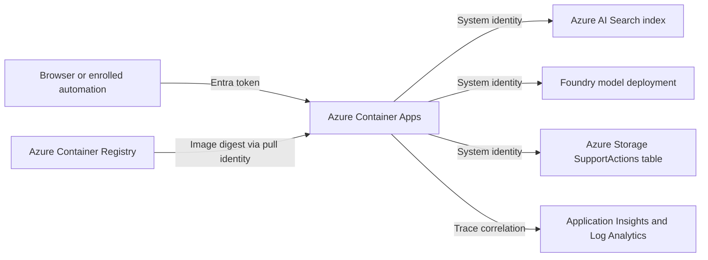

# Module 15 · Deploy and operate the application

Use PowerShell 7.2 or later and .NET 10.0.403 for the local checkpoints. From this directory, run the architecture lab, then use the lesson ID to run each remaining checkpoint. The working directory for the checkpoint code must be `lab`.

```powershell
Push-Location lab
try {
  dotnet run --project Operations.csproj
  dotnet run --project Operations.csproj -- 15.2
  dotnet run --project Operations.csproj -- 15.6 two-slots
} finally { Pop-Location }
```

| Lesson | Local checkpoint | Azure checkpoint |
| --- | --- | --- |
| 15.1 | Run without arguments. Identify the gateway, Search, Storage and model in the request trace. | Map the hosted services and identify which identity crosses each boundary. |
| 15.2 | Run `15.2`. Apply the test settings twice and verify the production fixture stays unchanged. | Review the Foundation Bicep what-if against your own lab group and compare its planned scopes. |
| 15.3 | Run `15.3`. Inspect the permission removed from the local role fixture. | Verify anonymous denial, authorized access, the runtime Search grant and durable replay. |
| 15.4 | Run `15.4`. Read the gate result and restored version. | Deploy a candidate at zero main-route traffic. Verify the traffic split and rollback. |
| 15.5 | Run `15.5` and `15.5 fast`. Compare trace duration and the alert decision. | Follow a real trace through the deployed app and compare measured usage with unit rates. |
| 15.6 | Run `15.6` and `15.6 two-slots`. Compare the observed concurrency and outcomes. | Verify one authenticated request to a faulted candidate returns the expected degraded result while the baseline answers. |
| 15.7 | Run `15.7`. Inspect the cache key, call count and cross-customer isolation. | Run a bounded comparison with the same cases, customer scopes and acceptance criteria. |
| 15.8 | Run `15.8`. Inspect the validation, cutover and isolated cleanup output. | Keep the baseline index through the rollback window, export receipts, then remove and verify the exact lab resources. |

The local program uses synthetic fixtures. For the hosted checkpoints, follow [the deployment runbook](deploy/README.md) with your approved Azure subscription, disposable group, Microsoft Entra registrations, Foundry deployment, seeded Search indexes and Entra-enabled Storage account. The launcher builds the sibling [Module 16 project](../module-16/lab/Capstone.csproj). Use your own resource names, client IDs and identities. Keep tokens and certificate private keys outside the course checkout. Use fixture data for every recording and test.



Before promotion, record the exact image digest, revision and index, the anonymous and authenticated outcomes, the expected citation, the customer scope and approval replay, and the trace ID. Use the same criteria for baseline and candidate. Keep the rollback revision and its dependencies until the deployment runbook’s cleanup checks pass.
